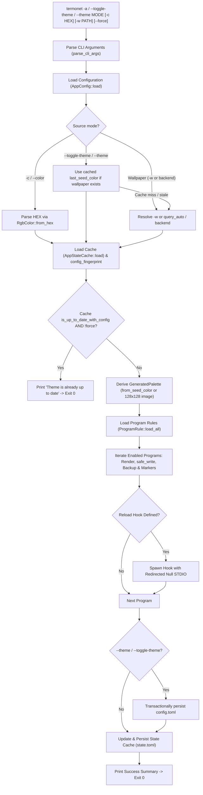
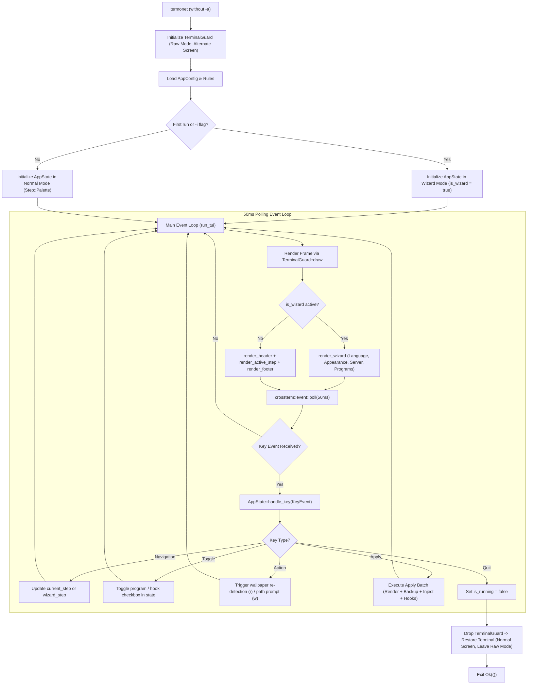
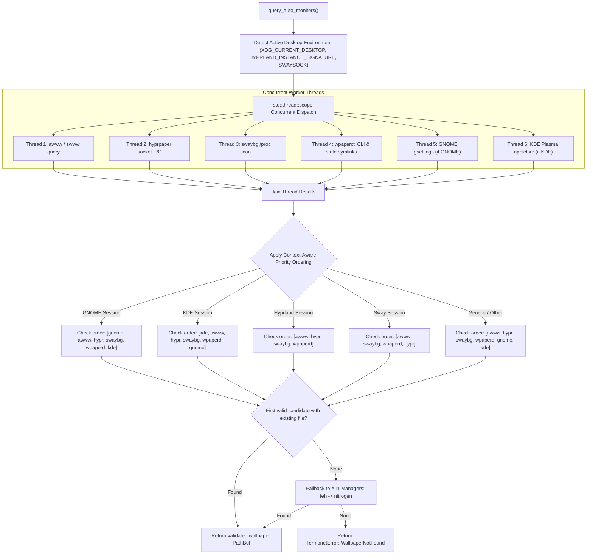
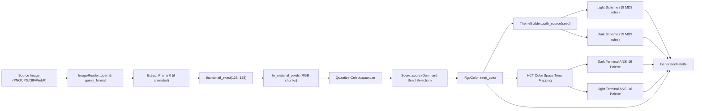
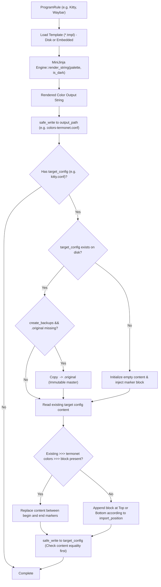
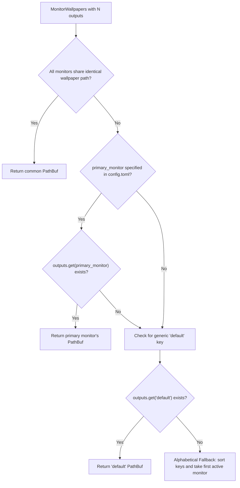

# Termonet — Architecture, Security Invariants & Development Guide

[English](ARCHITECTURE.md) | [Русский](ARCHITECTURE.ru.md) · [README](README.md)

> **Notice for AI Agents and Developers**: This document is the canonical, single-source-of-truth architectural specification and operational guide for the **Termonet** codebase (~13k lines of modern Rust across 36 source files). It details the complete subsystem layout, execution lifecycles, IPC mechanisms, security and data safety contracts, and extension playbooks. Consult this document before planning or applying code modifications.

---

## Table of Contents
1. [System Overview & Core Philosophy](#1-system-overview--core-philosophy)
2. [Repository Structure & Subsystem Breakdown](#2-repository-structure--subsystem-breakdown)
3. [Core Lifecycles & Data Flow Pipelines](#3-core-lifecycles--data-flow-pipelines)
   - [3.1 Headless CLI Pipeline (`--apply`, `--toggle-theme`, `--theme`, `--color`)](#31-headless-cli-pipeline---apply---toggle-theme---theme---color)
   - [3.2 Interactive TUI Lifecycle & State Machine](#32-interactive-tui-lifecycle--state-machine)
   - [3.3 Wallpaper Auto-Detection Concurrency & Session Context Priority](#33-wallpaper-auto-detection-concurrency--session-context-priority)
   - [3.4 Material Design 3 Quantization & Palette Derivation](#34-material-design-3-quantization--palette-derivation)
   - [3.5 Template Rendering, Master Backup & Marker Injection](#35-template-rendering-master-backup--marker-injection)
4. [Deep Dive: Wallpaper Detection & Multi-Monitor Resolution Subsystem](#4-deep-dive-wallpaper-detection--multi-monitor-resolution-subsystem)
   - [4.1 The `WallpaperProvider` Trait Contract](#41-the-wallpaperprovider-trait-contract)
   - [4.2 Backend Implementations & Query Mechanics](#42-backend-implementations--query-mechanics)
   - [4.3 Multi-Monitor Arbitration & Deduplication](#43-multi-monitor-arbitration--deduplication)
   - [4.4 Path Sanitization & Security Pipeline](#44-path-sanitization--security-pipeline)
   - [4.5 Diagnostics Framework (`--debug-wallpaper`)](#45-diagnostics-framework---debug-wallpaper)
5. [Configuration & Persistence Architecture](#5-configuration--persistence-architecture)
   - [5.1 XDG Path Management (`AppPaths`)](#51-xdg-path-management-apppaths)
   - [5.2 Configuration Schema Versioning & Migrations](#52-configuration-schema-versioning--migrations)
   - [5.3 Cache & State Invalidation (`state.toml`)](#53-cache--state-invalidation-statetoml)
6. [Core Invariants & Safety Contracts](#6-core-invariants--safety-contracts)
7. [Agent Extension & Modification Playbook](#7-agent-extension--modification-playbook)
   - [7.1 Adding a New Wallpaper Backend Provider](#71-adding-a-new-wallpaper-backend-provider)
   - [7.2 Adding or Updating an Application Rule & Template](#72-adding-or-updating-an-application-rule--template)
   - [7.3 Adding a New CLI Flag or Execution Mode](#73-adding-a-new-cli-flag-or-execution-mode)
   - [7.4 Adding a New TUI View, Setting, or Keybinding](#74-adding-a-new-tui-view-setting-or-keybinding)
8. [Testing, Benchmarking & Verification Standards](#8-testing-benchmarking--verification-standards)

---

## 1. System Overview & Core Philosophy

Termonet is a high-performance, dynamic Material You (Material Design 3) theme and palette generator for Linux environments (Wayland compositors, X11 window managers, and desktop environments). It extracts dominant color seeds from active desktop wallpapers, generates harmonized light and dark color schemes alongside 16-color ANSI terminal palettes, renders them via an embedded MiniJinja engine into target application configurations (terminals, status bars, application launchers, window managers), and safely injects them into existing user dotfiles without damaging custom settings.

### Core Architectural Pillars

1. **Zero Runtime & Interpreter Dependencies**:
   - Implemented in 100% pure Rust (Edition 2024).
   - Stripped binary with Thin LTO and `opt-level = 3` produces a standalone binary (~10 MB) that executes without Python or Node.js runtimes, invoking standard Linux system utilities (`gsettings`, `dbus-send`, `sh -c` for user-configured hooks, or compositor CLIs) only when querying desktop state or executing reload hooks.
2. **Safety & Non-Destructive File Modification**:
   - **Immutable Master Backups**: When `create_backups = true` in `config.toml`, Termonet creates an immutable `<filename>.original` snapshot before modifying a user dotfile for the first time (never overwritten).
   - **Isolated Marker Blocks**: Configuration injections are strictly contained between language-aware marker comments (`>>> termonet colors >>> ... <<< termonet colors <<<`). Everything outside these markers is left pristine.
   - **Safe Atomic Writes**: Files are checked for identical content before touching disk to avoid triggering inotify watches or updating filesystem `mtime` needlessly. When written, content is safely committed.
3. **Strict Domain Decoupling**:
   - **Pure Core**: The color extraction and math engine (`src/core/`) is isolated from all I/O, display protocols, and user interfaces.
   - **Display Server Agnosticism**: The wallpaper discovery subsystem (`src/wallpaper/`) isolates Wayland UNIX sockets, `/proc` scraping, and DBus invocations behind a clean `WallpaperProvider` trait.
   - **Dual Interface Modes**: Headless mode (`--apply`) and interactive Terminal UI (`ratatui`) share the exact same underlying business logic, rules, and configuration engine.
4. **Resilience to Linux Desktop Fragmentation**:
   - Instead of relying on a single desktop standard, Termonet incorporates multi-tiered fallback pipelines: direct UNIX domain socket IPC, tool-specific CLI invocations, and static configuration file parsers for each supported daemon.

---

## 2. Repository Structure & Subsystem Breakdown

The codebase consists of 36 Rust source files organized into 7 modular crates and domain packages:

```
src/
├── main.rs                   # Binary entry point, CLI flag parsing, and execution dispatch
├── lib.rs                    # Crate root, module re-exports, and global Result/TermonetError
├── error.rs                  # Strongly-typed error enum (TermonetError) using thiserror
├── cli/                      # Headless execution and apply automation
│   └── mod.rs                # Headless apply runner (run_cli_mode) and CliArgs
├── config/                   # XDG filesystem paths and application configuration
│   ├── mod.rs                # Public config re-exports
│   ├── paths.rs              # AppPaths: XDG directory resolution and ~ tilde expansion
│   ├── settings.rs           # AppConfig schema (v2), enums, dark-mode detector, commented TOML
│   └── state.rs              # AppStateCache persistence (~/.local/state/termonet/state.toml)
├── core/                     # Pure domain: image decoding, quantization, and palette math
│   ├── mod.rs                # Core module re-exports
│   ├── image.rs              # Image loading, animated GIF/WebP first-frame extraction, downscaling
│   ├── color.rs              # RgbColor (zero-alloc hex serialization), MaterialScheme, TerminalPalette
│   └── palette.rs            # GeneratedPalette, QuantizerCelebi, CAM16 scoring, ThemeBuilder
├── wallpaper/                # Wallpaper discovery, IPC protocols, and path sanitization
│   ├── mod.rs                # get_current_wallpaper routing and query_auto_monitors priority sequence
│   ├── monitor.rs            # MonitorWallpapers and multi-monitor resolution policies
│   ├── path.rs               # Percent-decoding, URL stripping, and disk file validation
│   ├── provider.rs           # WallpaperProvider trait, registry, and diagnostic runner
│   ├── wayland.rs            # Wayland daemons: awww, swww, hyprpaper (socket), swaybg, wpaperd
│   └── de.rs                 # Desktop environments: GNOME (gsettings) and KDE Plasma (appletsrc)
├── template/                 # MiniJinja template rendering, backups, and rule injection
│   ├── mod.rs                # Template module re-exports and asset synchronization
│   ├── backup.rs             # Master backup (.original), safety backup (.bak), and safe_write
│   ├── engine.rs             # TemplateEngine (MiniJinja wrapper with hex/strip/rgb filters)
│   ├── embedded.rs           # Inlined default templates (*.tmpl) and default rules (*.toml)
│   └── rules.rs              # ProgramRule schema, comment styles, and marker block injection
├── tui/                      # Interactive terminal interface built with Ratatui & Crossterm
│   ├── mod.rs                # run_tui event loop driver, 50ms polling, and footer rendering
│   ├── terminal.rs           # TerminalGuard RAII wrapper (raw mode and alternate screen)
│   ├── font.rs               # PixelFont bitmap font rendered using Unicode half-blocks (█, ▀, ▄)
│   ├── app.rs                # AppState machine, Step/WizardStep enums, and key event router
│   └── views/                # Modular view renderers
│       ├── mod.rs            # Views re-exports
│       ├── header.rs         # Responsive header logo, navigation tabs, and monitor badge
│       ├── palette.rs        # Seed color, Material 3 role grid, ANSI 16 palette, manual path dialog
│       ├── programs.rs       # Checkable target program list and rule metadata badges
│       ├── hooks.rs          # Checkable reload hook commands
│       ├── apply.rs          # Apply confirmation, execution summary, and live status
│       └── wizard.rs         # First-run onboarding wizard (Language, Theme, Server, Programs)
└── i18n/                     # Internationalization and localization catalogs
    ├── mod.rs                # get_translations lookup function
    └── locales.rs            # Translations struct with Russian and English string catalogs
```

### File-by-File Responsibilities & Key Types

| File Path | Primary Responsibilities | Key Structures / Functions |
| :--- | :--- | :--- |
| `src/main.rs` | CLI argument parsing (`parse_cli_args()`), help/version output, routing to CLI headless (`run_cli_mode_with_context()`) or TUI, pre-flight rule updates | `main()`, `parse_cli_args()`, `run_cli_mode_with_context()`, `sync_default_assets()` |
| `src/lib.rs` | Root crate definitions and re-exports of modules and global error types | `Result<T>`, `TermonetError` |
| `src/error.rs` | Strongly-typed operational errors across I/O, parsing, imaging, templates, and IPC | `enum TermonetError` (`Io`, `Image`, `TomlDe`, `TomlSer`, `Template`, `WallpaperNotFound`, `Config`) |
| `src/cli/mod.rs` | Headless batch orchestration (`--apply`, `--toggle-theme`, `--theme`, `-c/--color`) | `struct CliArgs`, `run_cli_mode(&CliArgs) -> Result<bool>`, `run_cli_mode_with_context()` |
| `src/config/state.rs` | Tracks last-applied wallpaper to eliminate redundant re-quantization | `struct AppStateCache`, `is_up_to_date()`, `save()` |
| `src/config/mod.rs` | Config module re-exports (`AppPaths`, `AppConfig`, enums) | Module re-exports |
| `src/config/paths.rs` | Canonical XDG directories (`~/.config/termonet/`, `~/.local/state/termonet/`) and tilde expansion | `struct AppPaths`, `expand_tilde(&str) -> PathBuf` |
| `src/config/settings.rs` | Full schema configuration persistence, schema migrations (v1 -> v2), system dark theme detection | `struct AppConfig`, `enum Language`, `enum TuiTheme`, `enum DisplayServer`, `enum WallpaperBackend`, `is_system_dark()` |
| `src/core/mod.rs` | Core module re-exports (`GeneratedPalette`, `MaterialScheme`, `RgbColor`) | Module re-exports |
| `src/core/image.rs` | High-performance image loading, animated first-frame extraction (GIF/WebP), downscaling | `load_and_preprocess_image()`, `to_material_pixels()`, `EXTRACTION_SIZE = 128` |
| `src/core/color.rs` | Zero-allocation RGB serialization, 19-role MD3 semantic scheme, ANSI terminal palette | `struct RgbColor`, `struct MaterialScheme` (19 roles), `struct TerminalPalette` |
| `src/core/palette.rs` | Material You CAM16 extraction, Celebi quantization, light/dark scheme resolution | `struct GeneratedPalette`, `from_image_path()`, `from_seed_color()` |
| `src/wallpaper/mod.rs` | Resolves active wallpaper path based on backend settings and multi-monitor policy | `get_current_wallpaper()`, `get_wallpaper_monitors()`, `query_auto_monitors()` |
| `src/wallpaper/monitor.rs` | Multi-monitor output storage and deduplication / primary monitor arbitration | `struct MonitorWallpapers`, `resolve_primary()` |
| `src/wallpaper/path.rs` | Percent-decoding, URL stripping, geometry/crop flag cleaning, filesystem verification | `clean_wallpaper_path()`, `sanitize_wallpaper_path()`, `percent_decode()` |
| `src/wallpaper/provider.rs` | Abstract wallpaper daemon interface and diagnostic reporting | `trait WallpaperProvider`, `struct ProviderDiagnostic`, `run_all_diagnostics()` |
| `src/wallpaper/wayland.rs` | Implementations for `awww`/`swww`, `hyprpaper` (UNIX domain socket), `swaybg`, `wpaperd` | `query_awww_or_swww()`, `query_hyprpaper()`, `query_swaybg()`, `query_wpaperd()` |
| `src/wallpaper/de.rs` | Implementations for GNOME (`gsettings`) and KDE Plasma (appletsrc config parser & theme resolution) | `query_gnome()`, `query_kde()`, `resolve_kde_theme_package()` |
| `src/template/mod.rs` | Template module re-exports and asset synchronization | `sync_default_assets()`, module re-exports |
| `src/template/engine.rs` | MiniJinja wrapper with custom color filters and context injection | `struct TemplateEngine`, `render_string()`, filters (`hex`, `strip`, `rgb`, `hypr_rgb`, `hypr_rgba`) |
| `src/template/backup.rs` | Non-destructive file protection: immutable master `.original`, temporary `.bak`, atomic write | `ensure_master_backup()`, `create_safety_backup()`, `safe_write()` |
| `src/template/rules.rs` | Target application rules, TOML deserialization, comment syntax selection, marker injection | `struct ProgramRule`, `enum CommentStyle`, `enum ImportPosition`, `inject_import()` |
| `src/template/embedded.rs` | Embedded default templates and TOML rules for out-of-the-box support | `DEFAULT_TEMPLATES`, `DEFAULT_RULES` |
| `src/tui/mod.rs` | Terminal UI event loop driver, 50ms polling, and footer status rendering | `run_tui()`, `render_footer()` |
| `src/tui/terminal.rs` | RAII lifecycle guard managing alternate screen buffer and raw mode enter/exit | `struct TerminalGuard`, `struct TuiTerminal` |
| `src/tui/font.rs` | 5px bitmap header logo generator rendered via Unicode half-blocks (█, ▀, ▄) | `struct PixelFont`, `render()`, `termonet_banner()` |
| `src/tui/app.rs` | Central TUI state machine, navigation step tracking, and keyboard event routing | `struct AppState`, `enum Step`, `enum WizardStep`, `enum EnvSubStep`, `handle_key()` |
| `src/tui/views/mod.rs` | View re-exports | `render_apply`, `render_header`, `render_hooks`, `render_palette`, `render_programs`, `render_wizard` |
| `src/tui/views/header.rs` | Responsive header logo, navigation tabs, and monitor badge | `render_header()` |
| `src/tui/views/palette.rs` | Seed color, Material 3 role grid, ANSI 16 palette, manual path dialog | `render_palette()` |
| `src/tui/views/programs.rs` | Checkable target program list and rule metadata badges | `render_programs()` |
| `src/tui/views/hooks.rs` | Checkable reload hook commands list | `render_hooks()` |
| `src/tui/views/apply.rs` | Apply confirmation, execution summary, and live status feedback | `render_apply()` |
| `src/tui/views/wizard.rs` | First-run onboarding wizard (Language, Theme, Server, Programs) | `render_wizard()` |
| `src/i18n/mod.rs` | Translation catalog dispatcher | `get_translations(Language)` |
| `src/i18n/locales.rs` | Localization catalogs for English (`EN_TRANSLATIONS`) and Russian (`RU_TRANSLATIONS`) | `struct Translations` |

---

## 3. Core Lifecycles & Data Flow Pipelines

### 3.1 Headless CLI Pipeline (`--apply`, `--toggle-theme`, `--theme`, `--color`)

The headless CLI pipeline is executed via `termonet -a` (`--apply`), `--toggle-theme`, or `--theme <dark|light>` (optionally combined with `-c/--color <HEX>` or `-w/--wallpaper <PATH>`). It is designed for lightweight automation, compositor hotkeys, systemd user services, and wallpaper daemon change hooks (e.g., triggered whenever `swww` or `hyprpaper` switches images).



#### Pipeline Steps:
1. **Pre-flight & Config Resolution**: Parses flags strictly (rejecting unknown options), loads `~/.config/termonet/config.toml` once, and applies `--backup` / `--no-backup` overrides.
2. **Theme Mode & Palette Source**:
   - `--theme <dark|light>` or `--toggle-theme` determines target `is_dark` in memory without mutating `config.toml` yet.
   - `-c/--color <HEX>` validates the seed color and skips all wallpaper backend queries.
   - `--toggle-theme` / `--theme` without `-w` reuses `last_seed_color` from `state.toml` (when `last_wallpaper_path` still exists or was a standalone color) to switch themes in milliseconds without re-decoding images.
   - Otherwise, `-w` (tilde-expanded and verified) or the configured `WallpaperBackend` resolves the active wallpaper.
3. **Idempotency Guard**: Compares the resolved source (`CacheSource::Wallpaper` or `CacheSource::Color`), target `is_dark`, and `config_fingerprint` against `~/.local/state/termonet/state.toml`. If unchanged and `--force` is absent, execution finishes immediately without image decoding or disk writes.
4. **Color Derivation**: Either derives directly from the HEX seed (`from_seed_color`), or loads the image into memory, extracts frame 0 (for animated GIF/WebP), resizes to 128x128, extracts the seed via Celebi quantization, and builds full Material You (CAM16) light/dark and ANSI terminal palettes.
5. **Rule Rendering & Atomic Injection**:
   - For every program in `config.enabled_programs`, loads rule definition (`.toml`) and template (`.tmpl`).
   - Renders color palette with MiniJinja.
   - Writes rendered output file atomically via `safe_write()`.
   - If `target_config` is configured: creates `.original` master backup when `create_backups = true`, locates existing marker block or injects a new block, and writes updated target config.
6. **Hook Invocation**: Executes non-empty `reload_cmd` hooks (e.g. `killall -SIGUSR2 waybar` or `hyprctl reload`) with detached null stdio.
7. **Transactional Persistence**: If `--theme` / `--toggle-theme` succeeded, saves updated `config.toml`, then writes updated state and `last_config_fingerprint` to `state.toml`.

---

### 3.2 Interactive TUI Lifecycle & State Machine

The interactive TUI mode is invoked when running `termonet` without `-a`. It provides a responsive, keyboard-driven terminal dashboard built on `ratatui` and `crossterm`.



#### State Machine Layout (`AppState`):
- **`current_step`**: Enum representing active top-level view:
  - `Step::Palette (0)`: Displays seed color, Material 3 semantic roles, and ANSI 16 terminal palette. Displays active multi-monitor pills (`[● DP-1] [○ HDMI-A-1]`) with live in-memory display cycling (`Tab` / `m`). Pressing `w` or `o` opens the modal input dialog accepting either a wallpaper image path or a HEX color (`#385e72`, `0x...`, `abc`); `r` triggers daemon auto-detection.
  - `Step::Programs (1)`: Lists target applications with enable/disable checkboxes (`Space`) and template/rule paths.
  - `Step::Hooks (2)`: Lists target reload commands with enable/disable toggles (`Space`).
  - `Step::Apply (3)`: Execution summary screen. Pressing `Enter` commits changes to disk, persists any display switch, and launches enabled reload hooks in detached background threads (`spawn_reload_hook_detached()`) so the TUI never stalls.
  - Exiting: pressing `q`, `Esc`, or `Ctrl+C` on the main screen sets `is_running = false` (whereas inside modals or the settings wizard, `Esc` cancels and rolls back unsaved edits).
- **`is_wizard` & `wizard_step`**: Onboarding wizard state machine:
  - `WizardStep::Language`: Select Russian or English interface.
  - `WizardStep::Appearance`: Select Dark, Light, or System luminance theme.
  - `WizardStep::Environment`: Select Wayland vs X11 and wallpaper backend daemon (`EnvSubStep::ServerAndBackend`). When multiple connected outputs have divergent active wallpapers, contextually inserts `EnvSubStep::Monitors` (Step 3.1) to pick the primary display.
  - `WizardStep::Programs`: Select default programs to theme.
  - `WizardStep::Finish`: Review settings and write initial `config.toml`.
- **`TerminalGuard` (RAII Safety)**: Implements `Drop` to ensure terminal state (raw mode disable, cursor show, alternate screen leave) is **always** restored, even in the event of an early return or unhandled panic.

---

### 3.3 Wallpaper Auto-Detection Concurrency & Session Context Priority

When `wallpaper_backend = "auto"` is configured (the default), Termonet leverages **concurrent worker threads** and **context-aware session prioritization** (`src/wallpaper/mod.rs`):



---

### 3.4 Material Design 3 Quantization & Palette Derivation

The palette derivation engine transforms arbitrary raster images into fully coherent, WCAG-contrast-compliant Material Design 3 theme palettes:



#### Derived Palette Roles (`MaterialScheme`):
The `MaterialScheme` struct contains exactly **19 semantic color roles** derived via CAM16:
- **Primary Roles**: `primary`, `on_primary`, `primary_container`, `on_primary_container`.
- **Secondary Roles**: `secondary`, `on_secondary`, `secondary_container`, `on_secondary_container`.
- **Tertiary Roles**: `tertiary`, `on_tertiary`.
- **Functional / Error Roles**: `error`, `on_error`.
- **Surface & Background Roles**: `surface`, `on_surface`, `surface_variant`, `on_surface_variant`, `background`, `on_background`.
- **Outline Role**: `outline`.
- **Terminal 16 ANSI Palette (`TerminalPalette`)**: Derived from HCT tonal slices to ensure high readability and contrast in terminal applications:
  - Normal (0..7): Black, Red, Green, Yellow, Blue, Magenta, Cyan, White.
  - Bright (8..15): Bright Black (Gray), Bright Red, Bright Green, Bright Yellow, Bright Blue, Bright Magenta, Bright Cyan, Bright White.

---

### 3.5 Template Rendering, Master Backup & Marker Injection

Termonet avoids destructive configuration overwrites through an atomic injection and backup strategy:



---

## 4. Deep Dive: Wallpaper Detection & Multi-Monitor Resolution Subsystem

The wallpaper discovery subsystem (`src/wallpaper/`) is the most platform-sensitive and complex component of Termonet due to the extreme fragmentation of Linux display servers, Wayland compositors, desktop environments, and standalone wallpaper daemons.

### 4.1 The `WallpaperProvider` Trait Contract

All backend integrations implement the `WallpaperProvider` trait (`src/wallpaper/provider.rs`):

```rust
pub trait WallpaperProvider: Send + Sync {
    /// Unique provider identifier (e.g. "awww", "hyprpaper", "gnome", "kde").
    fn id(&self) -> &'static str;

    /// Human-readable display label for TUI and diagnostics.
    fn display_name(&self) -> &'static str;

    /// Fast, non-blocking check whether this provider's service, socket, or binary exists.
    fn is_available(&self) -> bool;

    /// Queries the provider and returns active monitors mapped to validated wallpaper file paths.
    fn query(&self) -> Result<MonitorWallpapers>;

    /// Executes an in-depth diagnostic query for `--debug-wallpaper` reporting.
    fn query_diagnostic(&self) -> ProviderDiagnostic;
}
```

The provider registry is exposed via `all_providers() -> Vec<Box<dyn WallpaperProvider>>`, returning all registered integrations in priority order.

---

### 4.2 Backend Implementations & Query Mechanics

#### 1. `awww` / `swww` Daemon (`src/wallpaper/wayland.rs`)
- **Query Strategy**:
  1. CLI query with `--all` flag: executes `awww query --all` (captures custom and default namespaces).
  2. Fallback CLI: executes `swww query`.
  3. Disk cache inspection: If runtime socket exists (`$XDG_RUNTIME_DIR/awww.sock` or `swww.sock`), scans `~/.cache/awww/` and `~/.cache/swww/` for output state files.
- **Parsing Mechanics**:
  - Handles multi-monitor strings such as `DP-1: 2560x1440, scale: 1, currently displaying: /path/to/img.png` and lines with filter prefixes like `currently displaying: crop:center Lanczos3 /path/to/img.png`.
  - Rejects solid color layers (e.g. `currently displaying: color: 000000`).
  - Distinguishes namespaces: lines starting with `: DP-1` belong to the default namespace; prefixed namespaces (e.g. `overlay: DP-1`) are segregated.

#### 2. `hyprpaper` Daemon (`src/wallpaper/wayland.rs`)
- **Query Strategy**:
  1. **Direct UNIX Domain Socket IPC**:
     - Connects directly to `$XDG_RUNTIME_DIR/hypr/$HYPRLAND_INSTANCE_SIGNATURE/.hyprpaper.sock`.
     - Sets strict 150 ms read and write timeouts (`set_read_timeout`, `set_write_timeout`) to eliminate any possibility of hanging the TUI or CLI process if the daemon is frozen.
     - Transmits `listactive\n` and parses the socket response.
  2. **CLI Fallback**: Executes `hyprctl hyprpaper listactive`.
  3. **Static Config Fallback**: If the daemon is temporarily offline, parses `~/.config/hypr/hyprpaper.conf`.
- **Parsing Mechanics**:
  - Output formats: `DP-1 = /path/to/wall.png`, `eDP-1 = /path/to/wall.png (scale: 1.0)`, or single-line `/path/to/wall.png`.
  - Config parser supports both legacy syntax (`wallpaper = DP-1,/path/to/wall.png` or `wallpaper = ,/path/to/wall.png`) and modern block syntax:
    ```ini
    wallpaper {
        monitor = DP-1
        path = /path/to/wall.png
    }
    ```
  - Discards `preload = ...` statements and `#` inline comments.

#### 3. `swaybg` Daemon (`src/wallpaper/wayland.rs`)
- **Query Strategy**:
  - Because `swaybg` does not expose an IPC socket or query command, Termonet scans the Linux `/proc` filesystem on the fly.
  - Iterates `/proc/[0-9]*/cmdline`.
  - Filters processes where the command line matches `swaybg`.
  - Extracts `-i` / `--image` (wallpaper path) and `-o` / `--output` (monitor name).
  - If `-o` is omitted, the wallpaper is assigned to all monitors under the `"default"` key.

#### 4. `wpaperd` Daemon (`src/wallpaper/wayland.rs`)
- **Query Strategy**:
  - Invokes CLI tool `wpaperctl all-wallpapers` and parses output formatted as `<monitor>: <path>`.
  - Fallback: Inspects state directory symlinks in `$XDG_STATE_HOME/wpaperd/wallpapers`, `~/.local/state/wpaperd/wallpapers`, and `~/.cache/wpaperd` to resolve active monitor wallpaper paths.

#### 5. GNOME Desktop Environment (`src/wallpaper/de.rs`)
- **Query Strategy**:
  1. **Option Check**: Runs `gsettings get org.gnome.desktop.background picture-options`. If set to `'none'`, wallpaper rendering is disabled and an error is returned immediately.
  2. **Theme Detection**: Runs `gsettings get org.gnome.desktop.interface color-scheme` to detect if dark mode is active (`prefer-dark`).
  3. **Key Query**:
     - If dark mode: queries `picture-uri-dark` first; if empty or file does not exist, falls back to `picture-uri`.
     - If light mode: queries `picture-uri` first; falls back to `picture-uri-dark`.
  4. Strips surrounding quotes, `file://` URI scheme, and percent-decodes URL paths.

#### 6. KDE Plasma Desktop Environment (`src/wallpaper/de.rs`)
- **Query Strategy**:
  1. **Configuration Parsing**:
     - Inspects `$XDG_CONFIG_HOME/plasma-org.kde.plasma.desktop-appletsrc` and `~/.config/plasma-org.kde.plasma.desktop-appletsrc`.
     - Parses desktop containment sections via `parse_kde_containments(&content)`: filters out panels, widgets, and disabled screens, and extracts configured image paths across desktop containments (including Plasma Folder View).
  2. **KDE Theme Package Resolution (`resolve_kde_theme_package`)**:
     - If the configured path points to a directory rather than an image file (standard for KDE wallpaper theme packages), Termonet inspects `contents/images/`.
     - Contextually selects dark vs light variant based on `is_system_dark()`.
     - Analyzes resolution filenames (e.g. `3840x2160.png`, `2560x1440.jpg`, `1920x1080.png`) and automatically picks the image with the highest pixel area.
  3. Validates that the resolved candidate is a regular file on disk and maps it to the respective monitor.

#### 7. X11 Tools (`feh` and `nitrogen`) (`src/wallpaper/provider.rs`)
- **`feh`**: Parses the shell script at `~/.fehbg` for `feh --bg-scale /path/to/image`.
- **`nitrogen`**: Parses INI configuration at `~/.config/nitrogen/bg-saved.cfg` for `file=/path/to/image` under monitor headers (`[xin_0]`, `[xin_1]`).

---

### 4.3 Multi-Monitor Arbitration & Deduplication

In multi-monitor setups, monitors often display different wallpapers. Termonet encapsulates multi-monitor state in `MonitorWallpapers`:

```rust
pub struct MonitorWallpapers {
    pub outputs: HashMap<String, PathBuf>,
}

impl MonitorWallpapers {
    pub fn new() -> Self;
    pub fn single(path: PathBuf) -> Self;
    pub fn resolve_primary(&self, primary_monitor: Option<&str>) -> Option<PathBuf>;
    pub fn has_divergent_wallpapers(&self) -> bool;
    pub fn sorted_outputs(&self) -> Vec<(String, PathBuf)>;
}
```

#### Deterministic Resolution Algorithm (`MonitorWallpapers::resolve_primary`):
The resolution algorithm follows a deterministic 4-stage policy:



#### Multi-Monitor Helpers & UI Integration:
1. **`has_divergent_wallpapers(&self) -> bool`**: Returns `true` only if `outputs.len() > 1` and at least two monitors report different wallpaper file paths. If all monitors display the same image, returns `false` to avoid spurious prompts.
2. **`sorted_outputs(&self) -> Vec<(String, PathBuf)>`**: Returns `(monitor_name, path)` pairs deterministically sorted alphabetically by monitor name.
3. **`get_wallpaper_monitors(backend, manual_path)`**: Queries backends directly, returning `Result<MonitorWallpapers>` without collapsing into a single primary path upfront.
4. **First-Run Wizard Contextual Step 3.1 (`EnvSubStep::Monitors`)**: When advancing from `WizardStep::Environment`, Termonet probes the selected backend via `get_wallpaper_monitors`. If divergent wallpapers are detected, it enters `EnvSubStep::Monitors` (Step 3.1) showing a radio list of discovered screens and paths to configure `primary_monitor`. If no divergence exists or the daemon query fails, it advances smoothly to Step 4 (Programs).
5. **Main TUI Live Display Cycling (`[Tab]` / `[m]`)**: On Step 1 (Palette), when divergent monitors are active, pills `[● DP-1]  [○ HDMI-A-1]` appear in the wallpaper card. Pressing `Tab` or `m` cycles through active displays, immediately updating the palette in memory. The selection is saved when the theme is applied in Step 4.

---

### 4.4 Path Sanitization & Security Pipeline

Wallpaper paths retrieved from daemons or user inputs are untrusted and frequently malformed. The sanitization pipeline (`src/wallpaper/path.rs`) runs every candidate through 8 consecutive security and normalization filters:

```mermaid
flowchart TD
    In["Raw Candidate String"] --> F1["1. Trim surrounding quotes (' or \") and whitespace"]
    F1 --> F2["2. Strip 'file://' URI scheme prefix"]
    F2 --> F3["3. Strip trailing tags in parens: (scale: 1.0), (mode: fill)"]
    F3 --> F4["4. Percent-Decode: %20 -> space, %D0%BF%D1%80... -> UTF-8 Cyrillic"]
    F4 --> F5["5. Strip crop flags: 'crop:center Lanczos3 /path' -> '/path'"]
    F5 --> F6["6. Reject solid color strings: 'color: 000000', '#1a2b3c', '0x...'"]
    F6 --> F7["7. Expand environment variables ($HOME, ${HOME}) and tilde (~)"]
    F7 --> F8["8. Filesystem Validation: path.exists() && path.is_file()"]
    F8 --> Out["Validated PathBuf or None"]
```

#### Sanitization Features:
- **Filename Parenthesis Preservation**: Filenames containing parentheses (e.g. `wallpaper (1).png` or `wall (copy).jpg`) are preserved; only trailing geometry tags starting with keywords (e.g. `scale:`, `fit:`, `mode:`) are stripped.
- **Full UTF-8 Multibyte Support**: Custom percent decoder parses byte triplets without allocating external regex engines, handling Cyrillic, Asian, and special characters.
- **Physical Disk Existence**: Candidates that do not physically exist on disk as regular files are discarded.

---

### 4.5 Diagnostics Framework (`--debug-wallpaper`)

Running `termonet --debug-wallpaper` triggers `run_all_diagnostics()` across every registered provider. It outputs a formatted diagnostic report for troubleshooting:

```text
==============================================================================
                        Termonet Wallpaper Diagnostics
==============================================================================

Desktop Environment: Hyprland
Session Type:        wayland
------------------------------------------------------------------------------
[awww / swww]  ✔ ACTIVE & DETECTED
  Output / State:
    Command 'awww query --all':
      DP-1: 2560x1440, scale: 1, currently displaying: /home/user/Pictures/nature.png
  Active Monitors:
    • DP-1 => /home/user/Pictures/nature.png

[swaybg]  ✘ NOT FOUND / INACTIVE
```

---

## 5. Configuration & Persistence Architecture

### 5.1 XDG Path Management (`AppPaths`)

Termonet adheres strictly to the FreeDesktop XDG Base Directory Specification via `src/config/paths.rs`:

| Directory / File | Standard Linux Location | Purpose |
| :--- | :--- | :--- |
| **Config Directory** | `~/.config/termonet/` | Base directory for user configuration and overrides |
| **Config File** | `~/.config/termonet/config.toml` | Main user configuration |
| **Templates Directory** | `~/.config/termonet/templates/` | Custom user MiniJinja templates (`*.tmpl`) |
| **Rules Directory** | `~/.config/termonet/rules/` | Custom user program rules (`*.toml`) |
| **State Directory** | `~/.local/state/termonet/` | Runtime state and cache directory |
| **State Cache File** | `~/.local/state/termonet/state.toml` | Tracks last processed wallpaper to skip duplicate work |

#### Tilde Expansion (`AppPaths::expand_tilde`):
Paths starting with `~/` or bare `~` are expanded against the user's `$HOME` environment variable. Absolute paths (`/usr/...`) and relative paths are preserved without modification.

---

### 5.2 Configuration Schema Versioning & Migrations

Configuration persistence is managed in `src/config/settings.rs` under schema version:

```rust
const CONFIG_SCHEMA_VERSION: u32 = 2;
```

#### Configuration Structure (`AppConfig`):
```rust
pub struct AppConfig {
    pub language: Language,                      // "ru" | "en"
    pub tui_theme: TuiTheme,                     // "dark" | "light" | "system"
    pub font_mode: FontMode,                     // "pixel" | "standard"
    pub display_server: DisplayServer,           // "wayland" | "x11"
    pub wallpaper_backend: WallpaperBackend,     // "auto" | "swww" | "hyprpaper" | ...
    pub primary_monitor: Option<String>,         // e.g. Some("eDP-1")
    pub enabled_programs: Vec<String>,           // ["kitty", "waybar", "rofi", "hyprland"]
    pub manual_wallpaper_path: Option<String>,  // Path override if backend = "manual"
    pub create_backups: bool,                    // true creates .original and .bak
}
```

#### Automatic Migration & Comment Preservation:
- When an outdated Termonet header schema (`# Termonet Configuration (Schema vN)` with `N < CONFIG_SCHEMA_VERSION`, or legacy header without version) or missing configuration file is encountered, Termonet automatically generates a fully documented, commented configuration file (`to_commented_toml()`).
- Minimal custom user configs that do not start with `# Termonet Configuration` are preserved as-is (`needs_migration()` returns `false`), with omitted keys filled by `Default` values during deserialization.
- Embedded rules synchronize automatically: if an embedded default rule has a higher `version` integer than a file on disk, the embedded modern rule is used.

---

### 5.3 Cache & State Invalidation (`state.toml`)

The state caching layer (`src/config/state.rs`) prevents redundant processing:

```toml
# ~/.local/state/termonet/state.toml
last_wallpaper_path = "/home/user/Pictures/wallpaper.png"
last_wallpaper_hash = "123456:1730000000000000000"
last_seed_color = "#385e72"
last_is_dark = true
last_config_fingerprint = "0123456789abcdef"
```

#### Validation Logic (`AppStateCache::is_up_to_date`):
1. **Strict Fingerprint & Source Check**: For wallpaper mode, requires matching `last_wallpaper_path` (direct or via `fs::canonicalize()` for symlinks/relative paths) **and** a valid present `last_wallpaper_hash` matching `(len:mtime_nanos)`; missing hash triggers invalidation. For `--color` mode, matches `last_seed_color`.
2. **Theme & Config Fingerprint Match**: Verifies both `last_is_dark == is_dark` and `last_config_fingerprint == config_fingerprint` (derived from `enabled_programs`, rules, and templates so modifying rules or target selection invalidates cached state).
3. **Bypass Flag**: The `-f` / `--force` CLI flag bypasses all cache checks.

---

## 6. Core Invariants & Safety Contracts

Every modification to the Termonet codebase must preserve these 6 core invariants:

### 1. The Zero-Panic Invariant
- **Rule**: Production code must **never** call `.unwrap()`, `.expect()`, `panic!()`, `todo!()`, or `unimplemented!()`.
- **Enforcement**: All fallible operations return `crate::error::Result<T>`. Errors are converted into `TermonetError` via `?` or explicit mapping. Production non-test code contains exactly 0 calls to `.unwrap()` and `.expect()` across the entire codebase. Unhandled errors must display user-friendly contextual messages rather than stack traces.

### 2. Master Backup Immutability (`.original`)
- **Rule**: When `create_backups = true`, the initial modification of any user dotfile creates `<filename>.original`.
- **Contract**: `<filename>.original` is created **only once** (if it does not already exist). It is **never overwritten** on subsequent runs. This guarantees that the user can always restore their pristine configuration even after months of theme changes.

### 3. Marker Block Isolation
- **Rule**: Injected imports in user configuration files must strictly reside between the begin and end markers:
  ```
  # >>> termonet colors >>>
  include colors-termonet.conf
  # <<< termonet colors <<<
  ```
- **Contract**: Content outside of these markers must never be touched, reordered, or deleted.

### 4. Safe Atomic File Operations
- **Rule**: File writes must be atomic and conservative.
- **Contract**: `safe_write()` resolves symlinks via `fs::symlink_metadata()` + `fs::canonicalize()` (refusing dangling symlinks and directories) so symlinks themselves are never overwritten. It preserves existing POSIX file permissions, skips disk writes entirely when existing content is byte-identical (avoiding unnecessary `mtime` watcher reloads), creates parent directories via `fs::create_dir_all()`, and writes atomically via a collision-safe temporary file (`.{name}.tmp.{pid}.{seq}`) + `fs::rename()`.

### 5. Path Sanitization & Validation
- **Rule**: No wallpaper path from external daemons or user input may be passed to the image processing engine without full sanitization.
- **Contract**: All paths must pass through `clean_wallpaper_path()` / `validate_wallpaper_path()` (quote removal, percent-decoding, URL stripping, and physical disk verification) before being returned by providers. Non-existent files must be filtered out or return `TermonetError::WallpaperNotFound`.

### 6. Subprocess Decoupling & Non-Blocking IPC
- **Rule**: Probing external daemons, sockets, or reload hooks must never stall the application.
- **Contract**: UNIX domain sockets must use strict timeouts (<= 150 ms). Subprocesses (`sh -c`) must redirect `stdin`, `stdout`, and `stderr` to `Stdio::null()` unless capturing output, preventing zombie processes or buffer deadlocks.

---

## 7. Agent Extension & Modification Playbook

This playbook provides step-by-step implementation instructions for common agent tasks.

---

### 7.1 Adding a New Wallpaper Backend Provider

**Objective**: Integrate a new wallpaper manager (e.g. `mpvpaper` or `swaybg-ng`).

#### Steps:
1. **Define the Provider Struct**:
   In `src/wallpaper/provider.rs` (using the internal `which()` `PATH` helper) or `src/wallpaper/wayland.rs` (checking runtime socket/binary via `PATH` lookup without spawning `Command::new("which")`), create the provider:
   ```rust
   use crate::wallpaper::provider::{WallpaperProvider, ProviderDiagnostic};
   use crate::wallpaper::monitor::MonitorWallpapers;
   use crate::error::{Result, TermonetError};

   pub struct MpvpaperProvider;

   impl WallpaperProvider for MpvpaperProvider {
       fn id(&self) -> &'static str { "mpvpaper" }
       fn display_name(&self) -> &'static str { "mpvpaper" }
       fn is_available(&self) -> bool {
           which("mpvpaper") // pure-Rust PATH lookup in src/wallpaper/provider.rs
       }
       fn query(&self) -> Result<MonitorWallpapers> {
           // Implement socket IPC or CLI output parsing
           // Always sanitize paths via clean_wallpaper_path
       }
       fn query_diagnostic(&self) -> ProviderDiagnostic { ... }
   }
   ```
2. **Register in Provider Registry**:
   In `src/wallpaper/provider.rs`, add the provider to `all_providers()`:
   ```rust
   pub fn all_providers() -> Vec<Box<dyn WallpaperProvider>> {
       vec![
           Box::new(AwwwProvider),
           Box::new(HyprpaperProvider),
           Box::new(MpvpaperProvider), // <-- Add here
           ...
       ]
   }
   ```
3. **Add Backend Enum Variant & Wizard Mapping**:
   In `src/config/settings.rs`, add the variant to `WallpaperBackend` and include it in `DisplayServer::supported_backends()` so it appears in the setup wizard:
   ```rust
   pub enum WallpaperBackend {
       Auto,
       Swww,
       Awww,
       Hyprpaper,
       Mpvpaper, // <-- Add here
       ...
   }
   ```
4. **Wire Dispatch in `src/wallpaper/mod.rs`**:
   Add branches to both `get_wallpaper_monitors()` and `get_current_wallpaper()` (for display label formatting):
   ```rust
   WallpaperBackend::Mpvpaper => wayland::query_mpvpaper(),
   ```

---

### 7.2 Adding or Updating an Application Rule & Template

**Objective**: Add support for a new program (e.g. `foot` terminal or `fuzzel` launcher).

In Termonet, default rules and templates are stored as standalone files in the repository's `assets/` directory and compiled into the binary via `include_str!`.

#### Steps:
1. **Create the Template File**:
   Create `assets/templates/fuzzel.tmpl`:
   ```ini
   # termonet-version: 1
   [colors]
   background={{ active.surface.strip }}ff
   text={{ active.on_surface.strip }}ff
   match={{ active.primary.strip }}ff
   selection={{ active.primary_container.strip }}ff
   selection-text={{ active.on_primary_container.strip }}ff
   border={{ active.outline.strip }}ff
   ```
2. **Create the Rule TOML File**:
   Create `assets/rules/fuzzel.toml`:
   ```toml
   version = 1
   name = "Fuzzel"
   template = "fuzzel.tmpl"
   output_path = "~/.config/fuzzel/colors-termonet.ini"
   target_config = "~/.config/fuzzel/fuzzel.ini"
   import_line = "include = ~/.config/fuzzel/colors-termonet.ini"
   import_position = "top"
   comment_style = "hash"
   ```
3. **Register Assets in `src/template/embedded.rs`**:
   ```rust
   pub const DEFAULT_TEMPLATES: &[(&str, &str)] = &[
       ...
       ("fuzzel.tmpl", include_str!("../../assets/templates/fuzzel.tmpl")),
   ];

   pub const DEFAULT_RULES: &[(&str, &str)] = &[
       ...
       ("fuzzel.toml", include_str!("../../assets/rules/fuzzel.toml")),
   ];
   ```
4. **If Modifying an Existing Rule**:
   - Increment `version = 2` in the rule TOML (e.g. `assets/rules/kitty.toml`).
   - Termonet's rule synchronization (`sync_default_assets()`) automatically compares versions and creates a `<file>.v{old}.bak` backup before upgrading outdated user configs!

---

### 7.3 Adding a New CLI Flag or Execution Mode

**Objective**: Add a new flag (e.g. `--contrast <LEVEL>`).

#### Steps:
1. **Update `CliArgs`**:
   In `src/cli/mod.rs`:
   ```rust
   pub struct CliArgs {
       ...
       pub contrast: Option<f64>,
   }
   ```
2. **Update Argument Parsing in `src/main.rs`**:
   In `src/main.rs`, update `parse_cli_args()` with strict argument validation (rejecting missing values or flags passed as values):
   ```rust
   "--contrast" => {
       if i + 1 < args.len() && !args[i + 1].starts_with('-') {
           let val = args[i + 1].parse::<f64>().map_err(|_| {
               termonet::error::TermonetError::Config(
                   "Option '--contrast' requires a numeric value".into(),
               )
           })?;
           cli_args.contrast = Some(val);
           i += 1;
       } else {
           return Err(termonet::error::TermonetError::Config(
               "Option '--contrast' requires a numeric argument".into(),
           ));
       }
   }
   ```
3. **Update `--help` Text**:
   Add documentation to the `-h` / `--help` branch in `src/main.rs`.

---

### 7.4 Adding a New TUI View, Setting, or Keybinding

**Objective**: Add a hotkey (e.g. `c` to toggle high contrast mode).

#### Steps:
1. **Handle Key in State Machine**:
   In `src/tui/app.rs`, add a branch to `AppState::handle_key`:
   ```rust
   KeyCode::Char('c') => {
       self.toggle_high_contrast();
   }
   ```
2. **Update Footer Bar**:
   In `src/tui/mod.rs`, add the key hint in `render_footer`:
   ```rust
   footer_spans.push(Span::styled(" [c] ", Style::default().fg(primary_color).add_modifier(Modifier::BOLD)));
   footer_spans.push(Span::styled("Contrast  ", Style::default().fg(text_muted)));
   ```
3. **Update Translations**:
   In `src/i18n/locales.rs`, add corresponding string fields to `Translations` for English and Russian catalogs.

---

## 8. Testing, Benchmarking & Verification Standards

To maintain long-term codebase stability and prevent regressions in color extraction, file backups, or display protocols, Termonet enforces rigorous testing practices:

### 1. Test Suite Execution (`cargo test`)
Run the full test suite before committing changes:
```bash
cargo test
```
All tests must pass cleanly with zero warnings.

### 2. TUI Headless Testing (`TestBackend`)
When testing TUI widgets, views, and header layouts, **never** attempt to allocate an actual terminal device. Instead, use Ratatui's headless `TestBackend` with public view functions:
```rust
use ratatui::backend::TestBackend;
use ratatui::Terminal;
use termonet::tui::views::render_header;
use termonet::tui::AppState;
use termonet::config::AppConfig;

#[test]
fn test_header_renders_correctly() {
    let backend = TestBackend::new(120, 30);
    let mut terminal = Terminal::new(backend).expect("Failed to create test terminal");
    let state = AppState::new(AppConfig::default());

    terminal.draw(|f| {
        render_header(f, f.area(), &state);
    }).expect("Draw failed");

    let buffer = terminal.backend().buffer();
    // Assert on buffer cell contents
}
```

### 3. Isolated Filesystem Tests
Tests that test file writes, backups, or marker injections must create an isolated temporary directory using unique paths (e.g. `std::env::temp_dir().join(format!("termonet_test_{}", std::process::id()))`) and clean up after execution to prevent interfering with user files or parallel test runners.

### 4. Zero Warning Linting
The codebase is audited with strict clippy checks:
```bash
cargo clippy -- -D warnings
```
Code must compile with zero compiler warnings and zero clippy warnings.

### 5. Fast Development Profiles
Because image decoding and color quantization can be slow in unoptimized debug builds, `Cargo.toml` configures package optimizations even for dev profile:
```toml
[profile.dev.package."*"]
opt-level = 3
```
This ensures tests and local runs execute with near-release speed while preserving debug symbols.

---
*End of Architecture Specification.*
