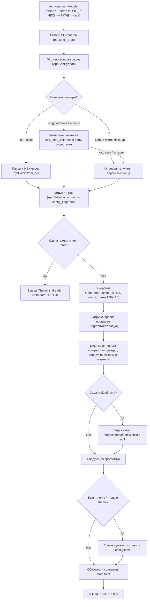
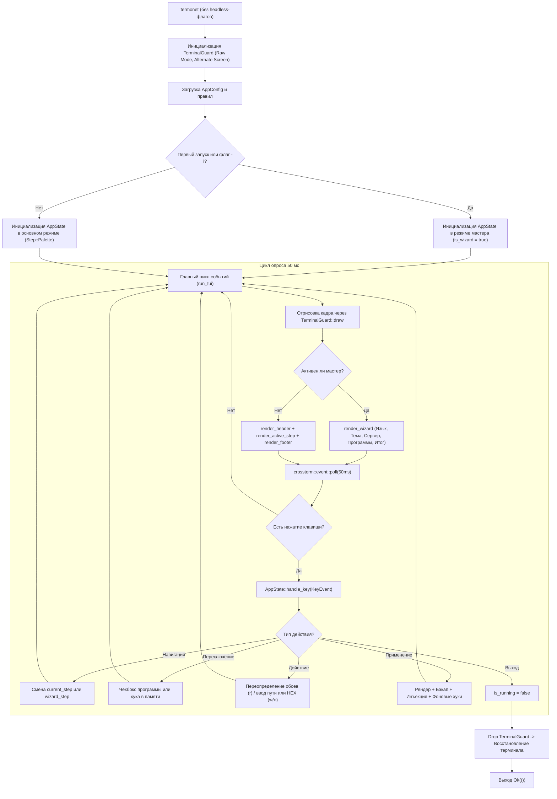
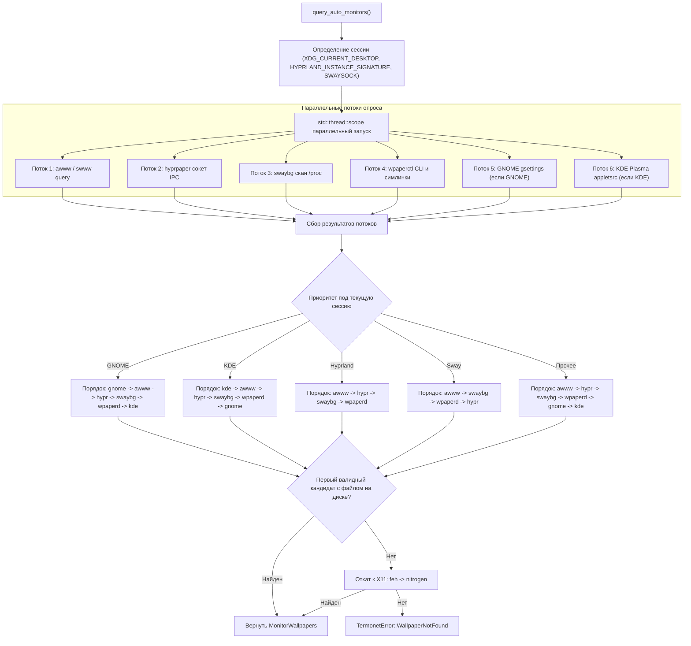
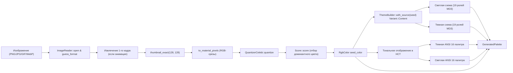
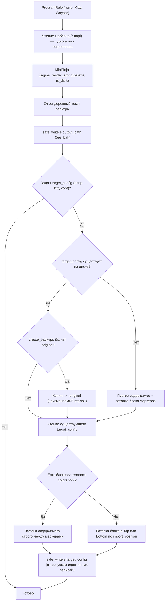
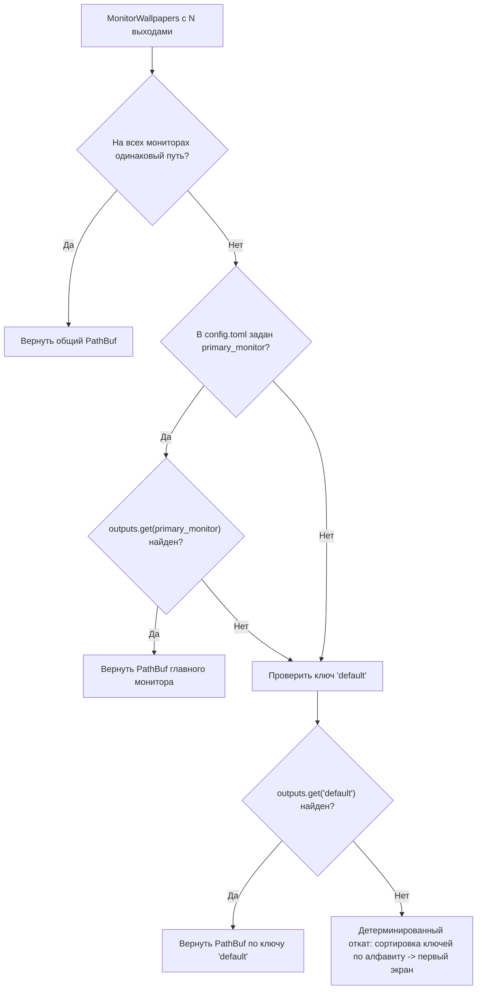

# Termonet — Архитектура, инварианты безопасности и руководство разработчика

[English](ARCHITECTURE.md) | [Русский](ARCHITECTURE.ru.md) · [README](README.ru.md)

> **Памятка для разработчиков и ИИ-агентов**: Этот документ является каноническим, единым источником истины по архитектуре и внутреннему устройству кодовой базы **Termonet** (~13 тыс. строк современного Rust в 36 исходных файлах). Здесь описаны структура подсистем, жизненные циклы выполнения, механизмы IPC, контракты безопасности данных и руководства по расширению функциональности. Обращайтесь к этому документу перед планированием и внесением изменений в код.

---

## Содержание
1. [Обзор системы и ключевые принципы](#1-обзор-системы-и-ключевые-принципы)
2. [Структура репозитория и разбор подсистем](#2-структура-репозитория-и-разбор-подсистем)
3. [Основные жизненные циклы и потоки данных](#3-основные-жизненные-циклы-и-потоки-данных)
   - [3.1 Автономный CLI-конвейер (`--apply`, `--toggle-theme`, `--theme`, `--color`)](#31-автономный-cli-конвейер---apply---toggle-theme---theme---color)
   - [3.2 Жизненный цикл интерактивного TUI и конечный автомат](#32-жизненный-цикл-интерактивного-tui-и-конечный-автомат)
   - [3.3 Параллельное автоопределение обоев и приоритет окружения](#33-параллельное-автоопределение-обоев-и-приоритет-окружения)
   - [3.4 Квантование Material Design 3 и генерация палитры](#34-квантование-material-design-3-и-генерация-палитры)
   - [3.5 Рендеринг шаблонов, эталонные бэкапы и инъекция маркеров](#35-рендеринг-шаблонов-эталонные-бэкапы-и-инъекция-маркеров)
4. [Подсистема обнаружения обоев и мультимониторности](#4-подсистема-обнаружения-обоев-и-мультимониторности)
   - [4.1 Контракт трейта `WallpaperProvider`](#41-контракт-трейта-wallpaperprovider)
   - [4.2 Реализации бэкендов и механизмы опроса](#42-реализации-бэкендов-и-механизмы-опроса)
   - [4.3 Арбитраж мониторов и дедупликация](#43-арбитраж-мониторов-и-дедупликация)
   - [4.4 Конвейер санитизации и валидации путей](#44-конвейер-санитизации-и-валидации-путей)
   - [4.5 Фреймворк диагностики (`--debug-wallpaper`)](#45-фреймворк-диагностики---debug-wallpaper)
5. [Архитектура конфигурации и хранения состояния](#5-архитектура-конфигурации-и-хранения-состояния)
   - [5.1 Управление путями XDG (`AppPaths`)](#51-управление-путями-xdg-apppaths)
   - [5.2 Версионирование схемы конфигурации и миграции](#52-версионирование-схемы-конфигурации-и-миграции)
   - [5.3 Инвалидация кэша и состояния (`state.toml`)](#53-инвалидация-кэша-и-состояния-statetoml)
6. [Ключевые инварианты и контракты безопасности](#6-ключевые-инварианты-и-контракты-безопасности)
7. [Практическое руководство по расширению](#7-практическое-руководство-по-расширению)
   - [7.1 Добавление нового бэкенда обоев](#71-добавление-нового-бэкенда-обоев)
   - [7.2 Добавление или обновление правила и шаблона программы](#72-добавление-или-обновление-правила-и-шаблона-программы)
   - [7.3 Добавление нового CLI-флага или режима работы](#73-добавление-нового-cli-флага-или-режима-работы)
   - [7.4 Добавление нового экрана, настройки или клавиши TUI](#74-добавление-нового-экрана-настройки-или-клавиши-tui)
8. [Стандарты тестирования и верификации](#8-стандарты-тестирования-и-верификации)

---

## 1. Обзор системы и ключевые принципы

**Termonet** — высокопроизводительный динамический генератор тем Material You (Material Design 3) и цветовых палитр для Linux-окружений (Wayland-композиторов, оконных менеджеров X11 и полноценных DE). Программа извлекает доминантные цвета из текущих обоев рабочего стола (или заданного HEX-цвета), рассчитывает гармонизированные светлую и темную схемы вместе с 16-цветной ANSI-палитрой терминала, рендерит их через встроенный движок MiniJinja в конфиги целевых программ (терминалы, панели состояния, лаунчеры, оконные менеджеры) и аккуратно внедряет импорт в пользовательские dotfiles без повреждения остальных настроек.

### Базовые архитектурные опоры

1. **Отсутствие зависимостей от интерпретаторов в рантайме**:
   - Написано полностью на Rust (Edition 2024).
   - Сборка в `release` с Thin LTO, `opt-level = 3` и `strip = true` дает автономный бинарник без зависимостей от Python или Node.js; внешние системные утилиты (`gsettings`, `dbus-send`, `sh -c` для пользовательских хуков или CLI композиторов) вызываются только при опросе рабочего стола или перезагрузке тем.
2. **Безопасное и неразрушающее изменение файлов**:
   - **Неизменяемый эталонный бэкап**: при `create_backups = true` в `config.toml` перед первым изменением пользовательского конфига создается снимок `<filename>.original` (который никогда не перезаписывается).
   - **Изолированные блоки маркеров**: инъекции импортов строго ограничены комментариями-маркерами с учетом языка (`>>> termonet colors >>> ... <<< termonet colors <<<`). Всё содержимое за их пределами остается нетронутым.
   - **Безопасная атомарная запись**: перед записью на диск проверяется побайтовое совпадение содержимого, чтобы не дергать файловые вотчеры (`inotify`) и не обновлять `mtime` впустую.
3. **Строгое разделение доменов**:
   - **Чистое ядро**: извлечение цветов и математика палитр (`src/core/`) полностью изолированы от ввода-вывода, графических серверов и интерфейса.
   - **Независимость от графического сервера**: подсистема поиска обоев (`src/wallpaper/`) прячет UNIX-сокеты Wayland, чтение `/proc` и вызовы DBus за единым трейтом `WallpaperProvider`.
   - **Единая логика для CLI и TUI**: автономный режим (`--apply`, `--toggle-theme`, `--theme`) и интерактивный TUI (`ratatui`) используют одни и те же правила, шаблонизатор и конфиг-движок.
4. **Устойчивость к фрагментации Linux-десктопов**:
   - Вместо опоры на один стандарт Termonet строит многоуровневые цепочки отката: прямые UNIX domain sockets, специализированные CLI утилит и парсинг статических конфигов для каждого демона.

---

## 2. Структура репозитория и разбор подсистем

Кодовая база состоит из 36 файлов Rust, организованных в 7 модульных подсистем:

```text
src/
├── main.rs                   # Точка входа бинарника, парсинг CLI-флагов и диспетчеризация
├── lib.rs                    # Корень библиотеки, реэкспорты модулей, Result / TermonetError
├── error.rs                  # Типизированный enum ошибок (TermonetError) на thiserror
├── cli/                      # Автономное CLI-применение тем и автоматизация
│   └── mod.rs                # Исполнитель headless-режима (run_cli_mode) и CliArgs
├── config/                   # Пути XDG и конфигурация приложения
│   ├── mod.rs                # Публичные реэкспорты конфигурации
│   ├── paths.rs              # AppPaths: резолв директорий XDG и раскрытие ~
│   ├── settings.rs           # Схема AppConfig (v2), enum-опции, детектор темной темы, TOML с комментариями
│   └── state.rs              # Персистентный кэш AppStateCache (~/.local/state/termonet/state.toml)
├── core/                     # Чистый домен: декодирование изображений, квантование, палитры
│   ├── mod.rs                # Реэкспорты ядра
│   ├── image.rs              # Загрузка картинок, извлечение 1-го кадра GIF/WebP, сжатие
│   ├── color.rs              # RgbColor (zero-alloc сериализация HEX), MaterialScheme, TerminalPalette
│   └── palette.rs            # GeneratedPalette, QuantizerCelebi, скоринг CAM16, ThemeBuilder
├── wallpaper/                # Поиск обоев, протоколы IPC и санитизация путей
│   ├── mod.rs                # Маршрутизация get_current_wallpaper и приоритеты query_auto_monitors
│   ├── monitor.rs            # MonitorWallpapers и политики выбора главного монитора
│   ├── path.rs               # Percent-декодирование, удаление file:// и валидация файлов на диске
│   ├── provider.rs           # Трейт WallpaperProvider, реестр провайдеров и диагностика
│   ├── wayland.rs            # Демоны Wayland: awww, swww, hyprpaper (сокет), swaybg, wpaperd
│   └── de.rs                 # Окружения рабочего стола: GNOME (gsettings) и KDE Plasma (appletsrc)
├── template/                 # Рендеринг MiniJinja, бэкапы и инъекция правил
│   ├── mod.rs                # Реэкспорты модуля шаблонов и синхронизация ассетов
│   ├── backup.rs             # Эталонный бэкап (.original), страховочный (.bak) и safe_write
│   ├── engine.rs             # TemplateEngine (обертка MiniJinja с фильтрами hex/strip/rgb)
│   ├── embedded.rs           # Вшитые дефолтные шаблоны (*.tmpl) и правила (*.toml)
│   └── rules.rs              # Схема ProgramRule, стили комментариев и вставка блоков маркеров
├── tui/                      # Интерактивный терминальный интерфейс на Ratatui и Crossterm
│   ├── mod.rs                # Цикл событий run_tui, опрос 50 мс и рендер нижней панели подсказок
│   ├── terminal.rs           # RAII-обертка TerminalGuard (raw mode и alternate screen)
│   ├── font.rs               # Битовый 5px шрифт PixelFont на полублоках Unicode (█, ▀, ▄)
│   ├── app.rs                # Конечный автомат AppState, Step/WizardStep и маршрутизация клавиш
│   └── views/                # Модульные рендереры экранов
│       ├── mod.rs            # Реэкспорты представлений
│       ├── header.rs         # Адаптивная шапка с логотипом, вкладками шагов и бейджем монитора
│       ├── palette.rs        # Seed-цвет, сетка ролей Material 3, 16 цветов ANSI, ввод пути/HEX
│       ├── programs.rs       # Список целевых программ с чекбоксами и метаданными правил
│       ├── hooks.rs          # Список команд перезапуска с переключением
│       ├── apply.rs          # Подтверждение применения, сводка и статус выполнения
│       └── wizard.rs         # Мастер настройки (Язык, Тема, Сервер, Программы, Итог)
└── i18n/                     # Интернационализация и словари локализации
    ├── mod.rs                # Диспетчер get_translations
    └── locales.rs            # Структура Translations с английским и русским словарями
```

### Ответственность файлов и ключевые сущности

| Путь | Основные задачи | Ключевые структуры / функции |
| :--- | :--- | :--- |
| `src/main.rs` | Парсинг аргументов CLI (`parse_cli_args()`), вывод `--help`/`--version`, маршрутизация в CLI или TUI | `main()`, `parse_cli_args()`, `resolve_tui_wallpaper()`, `handle_reset_rules()` |
| `src/lib.rs` | Корень крейта, реэкспорт модулей и типов ошибок | `Result<T>`, `TermonetError` |
| `src/error.rs` | Типизированные ошибки операций ввода-вывода, изображений, TOML, шаблонов и IPC | `enum TermonetError` (`Io`, `Image`, `TomlDe`, `TomlSer`, `Template`, `WallpaperNotFound`, `Config`) |
| `src/cli/mod.rs` | Автономная оркестрация (`--apply`, `--toggle-theme`, `--theme`, `-c/--color`) | `struct CliArgs`, `run_cli_mode(&CliArgs) -> Result<bool>`, `run_cli_mode_with_context()` |
| `src/config/state.rs` | Кэширование последних обоев, цвета, темы и отпечатка правил для пропуска лишней работы | `struct AppStateCache`, `enum CacheSource`, `is_up_to_date_with_config()`, `save()` |
| `src/config/mod.rs` | Реэкспорты модуля конфигурации (`AppPaths`, `AppConfig`, enum-ы) | Реэкспорты модуля |
| `src/config/paths.rs` | Канонические директории XDG (`~/.config/termonet/`, `~/.local/state/termonet/`) и раскрытие `~` | `struct AppPaths`, `expand_tilde(&str) -> PathBuf` |
| `src/config/settings.rs` | Хранение настроек, миграции схемы (v1 -> v2), детектор системной темной темы | `struct AppConfig`, `Language`, `TuiTheme`, `FontMode`, `DisplayServer`, `WallpaperBackend`, `is_system_dark()` |
| `src/core/mod.rs` | Реэкспорты доменного ядра (`GeneratedPalette`, `MaterialScheme`, `RgbColor`) | Реэкспорты модуля |
| `src/core/image.rs` | Загрузка изображений, извлечение первого кадра GIF/WebP, сжатие | `load_and_preprocess_image()`, `to_material_pixels()`, `EXTRACTION_SIZE = 128` |
| `src/core/color.rs` | Zero-alloc сериализация RGB, 19-ролевая схема MD3, парсер HEX, палитра ANSI | `struct RgbColor`, `from_hex()`, `struct MaterialScheme` (19 ролей), `struct TerminalPalette` |
| `src/core/palette.rs` | Извлечение цветов CAM16, квантование Celebi, генерация светлой/темной схем | `struct GeneratedPalette`, `from_image_path()`, `from_seed_color()` |
| `src/wallpaper/mod.rs` | Определение пути к обоям с учетом бэкенда и мультимониторной политики | `get_current_wallpaper()`, `get_wallpaper_monitors()`, `query_auto_monitors()` |
| `src/wallpaper/monitor.rs` | Хранение путей по мониторам, дедупликация и выбор главного экрана | `struct MonitorWallpapers`, `resolve_primary()` |
| `src/wallpaper/path.rs` | Percent-декодирование, удаление `file://`, очистка тегов геометрии, проверка файла на диске | `clean_wallpaper_path()`, `sanitize_wallpaper_path()`, `percent_decode()` |
| `src/wallpaper/provider.rs` | Абстрактный интерфейс провайдеров обоев и диагностический отчет | `trait WallpaperProvider`, `struct ProviderDiagnostic`, `run_all_diagnostics()` |
| `src/wallpaper/wayland.rs` | Интеграции `awww`/`swww`, `hyprpaper` (UNIX-сокет + конфиг), `swaybg`, `wpaperd` | `query_awww_or_swww()`, `query_hyprpaper()`, `query_swaybg()`, `query_wpaperd()` |
| `src/wallpaper/de.rs` | Интеграции GNOME (`gsettings`) и KDE Plasma (парсер `appletsrc` и пакетов тем) | `query_gnome()`, `query_kde()`, `resolve_kde_theme_package()` |
| `src/template/mod.rs` | Реэкспорты модуля шаблонов и синхронизация встроенных ассетов | `sync_default_assets()`, реэкспорты модуля |
| `src/template/engine.rs` | Обертка над MiniJinja с фильтрами цветов и контекстом переменных | `struct TemplateEngine`, `render_string()`, фильтры (`hex`, `strip`, `rgb`, `hypr_rgb`, `hypr_rgba`) |
| `src/template/backup.rs` | Защита конфигов: вечный `.original`, временный `.bak`, атомарная запись с сохранением симлинков | `ensure_master_backup()`, `create_safety_backup()`, `safe_write()` |
| `src/template/rules.rs` | Правила программ, парсинг TOML, стиль комментариев, инъекция маркеров, запуск хуков | `struct ProgramRule`, `CommentStyle`, `ImportPosition`, `inject_import()`, `spawn_reload_hook_detached()` |
| `src/template/embedded.rs` | Встроенные дефолтные шаблоны и TOML-правила (Kitty, Waybar, Rofi, Hyprland) | `DEFAULT_TEMPLATES`, `DEFAULT_RULES`, `sync_default_assets()` |
| `src/tui/mod.rs` | Драйвер цикла событий TUI (опрос 50 мс) и рендер нижней панели подсказок | `run_tui()`, `render_footer()` |
| `src/tui/terminal.rs` | RAII-обертка для безопасного входа/выхода из raw mode и alternate screen | `struct TerminalGuard`, `struct TuiTerminal` |
| `src/tui/font.rs` | Генератор 5px битового логотипа на полублоках Unicode (█, ▀, ▄) | `struct PixelFont`, `render()`, `termonet_banner()` |
| `src/tui/app.rs` | Главный конечный автомат TUI, переключение шагов и обработка клавиатуры | `struct AppState`, `enum Step`, `enum WizardStep`, `enum EnvSubStep`, `handle_key()` |
| `src/tui/views/mod.rs` | Реэкспорты представлений TUI | `render_apply`, `render_header`, `render_hooks`, `render_palette`, `render_programs`, `render_wizard` |
| `src/tui/views/header.rs` | Адаптивная шапка, вкладки шагов и индикатор активного монитора | `render_header()` |
| `src/tui/views/palette.rs` | Отображение seed-цвета, сетки Material 3, 16 цветов ANSI и модального окна пути/HEX | `render_palette()` |
| `src/tui/views/programs.rs` | Список программ с чекбоксами и путями правил | `render_programs()` |
| `src/tui/views/hooks.rs` | Список команд перезапуска с чекбоксами | `render_hooks()` |
| `src/tui/views/apply.rs` | Сводка перед записью, подтверждение и отображение статуса | `render_apply()` |
| `src/tui/views/wizard.rs` | Пошаговый мастер настройки (Язык, Тема, Сервер/Бэкенд, Мониторы, Программы) | `render_wizard()` |
| `src/i18n/mod.rs` | Диспетчер локализации | `get_translations(Language)` |
| `src/i18n/locales.rs` | Словари строк для английского (`EN_TRANSLATIONS`) и русского (`RU_TRANSLATIONS`) языков | `struct Translations` |

---

## 3. Основные жизненные циклы и потоки данных

### 3.1 Автономный CLI-конвейер (`--apply`, `--toggle-theme`, `--theme`, `--color`)

Автономный режим запускается через `termonet -a` (`--apply`), `--toggle-theme` или `--theme <dark|light>` (опционально с `-c/--color <HEX>` или `-w/--wallpaper <PATH>`). Он создан для скриптов автоматизации, горячих клавиш композиторов, юнитов `systemd` и хуков смены обоев в `swww`/`hyprpaper`.



#### Этапы конвейера:
1. **Предварительная проверка и конфиг**: флаги разбираются строго (неизвестные опции отклоняются), `~/.config/termonet/config.toml` читается один раз, применяются переопределения `--backup` / `--no-backup`.
2. **Определение режима темы и источника**:
   - `--theme <dark|light>` или `--toggle-theme` вычисляют целевой `is_dark` в памяти, не изменяя `config.toml` до окончания применения.
   - `-c/--color <HEX>` валидирует HEX-цвет и полностью пропускает опрос демонов обоев.
   - `--toggle-theme` / `--theme` без `-w` берут `last_seed_color` из `state.toml` (если файл обоев еще существует или ранее применялся автономный цвет), что позволяет переключать тему за миллисекунды без повторного декодирования картинки.
   - В остальных случаях используется путь из `-w` или опрос активного `WallpaperBackend`.
3. **Защита от холостых запусков**: сверяет источник (`CacheSource::Wallpaper` или `CacheSource::Color`), целевой `is_dark` и `config_fingerprint` с `~/.local/state/termonet/state.toml`. При полном совпадении и отсутствии `--force` работа завершается сразу без декодирования и записи на диск.
4. **Генерация палитры**: либо напрямую из seed-цвета (`from_seed_color`), либо через загрузку картинки в память, извлечение первого кадра (для GIF/WebP), сжатие до 128×128, квантование Celebi и расчет полной схемы Material You (CAM16) и 16 цветов ANSI.
5. **Рендеринг и атомарная инъекция**:
   - Для каждой программы из `config.enabled_programs` загружается правило (`.toml`) и шаблон (`.tmpl`).
   - Палитра рендерится движком MiniJinja и атомарно записывается через `safe_write()`.
   - Если задан `target_config`: при `create_backups = true` создается вечный эталон `.original`, затем обновляется блок между маркерами или добавляется новый блок, после чего конфиг безопасно записывается.
6. **Запуск хуков**: непустые `reload_cmd` запускаются с отвязанным stdio (`Stdio::null()`).
7. **Транзакционное сохранение**: только после успешного применения всех правил сохраняется обновленный `config.toml` (при `--theme`/`--toggle-theme`), а затем обновляется `state.toml` с новым `last_config_fingerprint`.

---

### 3.2 Жизненный цикл интерактивного TUI и конечный автомат

При запуске `termonet` без `-a`, `--toggle-theme` и `--theme` открывается интерактивный TUI-дашборд на `ratatui` и `crossterm`.



#### Структура конечного автомата (`AppState`):
- **`current_step`**: текущее окно верхней панели:
  - `Step::Palette (0)`: seed-цвет, 19 ролей Material 3 и 16 цветов ANSI. При разных обоях на мониторах отображает переключаемые бейджи (`[● DP-1] [○ HDMI-A-1]`, перебор по `Tab` / `m`). По клавишам `w` / `o` открывает модальное окно, принимающее как путь к изображению, так и HEX-цвет (`#385e72`, `0x...`, `abc`); `r` заново опрашивает демон обоев.
  - `Step::Programs (1)`: список программ с чекбоксами (`Пробел`) и метаданными правил.
  - `Step::Hooks (2)`: список команд перезапуска с переключением активности (`Пробел`).
  - `Step::Apply (3)`: сводка изменений. Нажатие `Enter` записывает палитры и импорты на диск, сохраняет выбор активного монитора и запускает включенные хуки в отвязанных фоновых потоках (`spawn_reload_hook_detached()`), чтобы интерфейс не зависал.
  - Выход: на основном экране `q`, `Esc` и `Ctrl+C` завершают работу (`is_running = false`); внутри модальных окон или мастера настроек `Esc` отменяет ввод и откатывает несохраненные правки конфига.
- **`is_wizard` и `wizard_step`**: пошаговый мастер настройки:
  - `WizardStep::Language`: выбор русского или английского языка.
  - `WizardStep::Appearance`: темная / светлая / системная тема и режим шрифта шапки (`pixel` / `standard`).
  - `WizardStep::Environment`: выбор Wayland или X11 и бэкенда обоев (`EnvSubStep::ServerAndBackend`). Если на нескольких мониторах стоят разные обои, динамически вставляется подшаг `EnvSubStep::Monitors` (шаг 3.1) для выбора `primary_monitor`.
  - `WizardStep::Programs`: выбор целевых программ.
  - `WizardStep::Finish`: проверка настроек, выбор режима бэкапов и сохранение `config.toml`.
- **`TerminalGuard` (RAII-гарантия)**: реализация `Drop` и `panic_hook` гарантируют выход из raw mode, возврат курсора и выход из alternate screen даже при раннем возврате ошибки или панике.

---

### 3.3 Параллельное автоопределение обоев и приоритет окружения

При `wallpaper_backend = "auto"` (значение по умолчанию) Termonet использует **параллельные потоки** (`std::thread::scope`) и **контекстную приоритизацию по активной сессии** (`src/wallpaper/mod.rs`):



---

### 3.4 Квантование Material Design 3 и генерация палитры

Конвейер генерации преобразует растровое изображение (или HEX-цвет) в согласованные светлую/темную схемы Material Design 3 и 16-цветную ANSI-палитру:



#### Роли палитры (`MaterialScheme`):
Структура `MaterialScheme` содержит ровно **19 семантических ролей**:
- **Primary**: `primary`, `on_primary`, `primary_container`, `on_primary_container`.
- **Secondary**: `secondary`, `on_secondary`, `secondary_container`, `on_secondary_container`.
- **Tertiary**: `tertiary`, `on_tertiary`.
- **Error**: `error`, `on_error`.
- **Surface и Background**: `surface`, `on_surface`, `surface_variant`, `on_surface_variant`, `background`, `on_background`.
- **Outline**: `outline`.
- **Терминальная палитра 16 ANSI (`TerminalPalette`)**: строится по тональным срезам HCT с учетом читаемости на темном и светлом фонах (цвета `color0..color15`, а также `background`, `foreground`, `cursor`).

---

### 3.5 Рендеринг шаблонов, эталонные бэкапы и инъекция маркеров



---

## 4. Подсистема обнаружения обоев и мультимониторности

### 4.1 Контракт трейта `WallpaperProvider`

Все интеграции менеджеров обоев реализуют трейт `WallpaperProvider` (`src/wallpaper/provider.rs`):

```rust
pub trait WallpaperProvider: Send + Sync {
    /// Уникальный идентификатор провайдера (напр. "awww", "hyprpaper", "gnome", "kde").
    fn id(&self) -> &'static str;

    /// Отображаемое имя для TUI и диагностики.
    fn display_name(&self) -> &'static str;

    /// Быстрая неблокирующая проверка наличия бинарника, сокета или конфига.
    fn is_available(&self) -> bool;

    /// Опрос провайдера и возврат карты мониторов с валидированными путями.
    fn query(&self) -> Result<MonitorWallpapers>;

    /// Подробный диагностический опрос для флага `--debug-wallpaper`.
    fn query_diagnostic(&self) -> ProviderDiagnostic;
}
```

Реестр всех зарегистрированных провайдеров доступен через `all_providers() -> Vec<Box<dyn WallpaperProvider>>`.

---

### 4.2 Реализации бэкендов и механизмы опроса

1. **`awww` / `swww` (`src/wallpaper/wayland.rs`)**:
   - Опрашивает `awww query --all` (чтобы захватить и кастомные неймспейсы), затем `swww query`, а при необходимости проверяет кэш-файлы в `$XDG_CACHE_HOME/awww` и `$XDG_CACHE_HOME/swww` при наличии сокета в `$XDG_RUNTIME_DIR`.
   - Отбрасывает заливки цветом (`color: 000000`), отдает приоритет дефолтному неймспейсу (`: DP-1:`), очищает фильтры вроде `crop:center Lanczos3`.
2. **`hyprpaper` (`src/wallpaper/wayland.rs`)**:
   - Прямой UNIX-сокет `$XDG_RUNTIME_DIR/hypr/$HYPRLAND_INSTANCE_SIGNATURE/.hyprpaper.sock` с таймаутами чтения/записи **150 мс** (`listactive\n`), откат на CLI `hyprctl hyprpaper listactive`, затем парсинг `$XDG_CONFIG_HOME/hypr/hyprpaper.conf` (поддерживает и старый строчный синтаксис `wallpaper = ...`, и новый блочный `wallpaper { monitor = ... path = ... }`).
3. **`swaybg` (`src/wallpaper/wayland.rs`)**:
   - Сканирует `/proc/[0-9]*/cmdline` процессов текущего UID, извлекает пары `-o`/`--output` и `-i`/`--image` (с учетом разделителей `\0` и нескольких запущенных процессов).
4. **`wpaperd` (`src/wallpaper/wayland.rs`)**:
   - Запускает `wpaperctl all-wallpapers`, при откате читает симлинки из `$XDG_STATE_HOME/wpaperd/wallpapers` (`~/.local/state/wpaperd/wallpapers`) и `~/.cache/wpaperd`.
5. **GNOME (`src/wallpaper/de.rs`)**:
   - Проверяет `picture-options != 'none'`, читает `color-scheme` через `gsettings`, в зависимости от темы запрашивает `picture-uri-dark` или `picture-uri` с взаимным откатом.
6. **KDE Plasma (`src/wallpaper/de.rs`)**:
   - Парсит `$XDG_CONFIG_HOME/plasma-org.kde.plasma.desktop-appletsrc` (или `~/.config/...`) через построчный автомат секций (`parse_kde_containments`), фильтруя панели и отключенные экраны (`lastScreen=-1`), а неактуальные ключи `usersWallpapers` игнорируются.
   - Если путь указывает на директорию пакета темы KDE, `resolve_kde_theme_package()` выбирает светлый/темный каталог (`contents/images/` или `contents/images_dark/`) и изображение максимального разрешения.
7. **X11 (`feh` и `nitrogen`) (`src/wallpaper/provider.rs`)**:
   - `feh`: shell-парсинг `~/.fehbg` с поддержкой кавычек, пробелов и комментариев.
   - `nitrogen`: парсинг `$XDG_CONFIG_HOME/nitrogen/bg-saved.cfg` (или `~/.config/nitrogen/bg-saved.cfg`).

---

### 4.3 Арбитраж мониторов и дедупликация

Мультимониторное состояние инкапсулировано в `MonitorWallpapers` (`src/wallpaper/monitor.rs`):



- `has_divergent_wallpapers()` возвращает `true` только если активно >1 монитора и пути на них различаются.
- При расхождении путей в мастере автоматически появляется шаг 3.1 (`EnvSubStep::Monitors`), а в основном TUI на шаге «Палитра» включаются табы мониторов (`Tab` / `m`).

---

### 4.4 Конвейер санитизации и валидации путей

Все кандидаты из демонов и пользовательского ввода проходят 8 шагов очистки в `src/wallpaper/path.rs`:
1. Удаление пробелов и внешних кавычек (`'...'`, `"..."`).
2. Удаление префикса `file://` (включая `file://localhost/`).
3. Срез служебных тегов в конце строки вроде `(scale: 1.0)`, `(mode: fill)` (при сохранении скобок в реальных именах файлов вроде `wall (1).png`).
4. Percent-декодирование (`%20`, UTF-8 кириллица и др.).
5. Срез флагов обрезки/масштабирования (`crop:center Lanczos3 /path` -> `/path`).
6. Отбрасывание заливок цветом (`color: 000000`, `#1a2b3c`, `0x...`).
7. Раскрытие переменных окружения (`$HOME`, `${HOME}`) и тильды (`~`).
8. Проверка физического существования обычного файла на диске (`path.exists() && path.is_file()`).

---

### 4.5 Фреймворк диагностики (`--debug-wallpaper`)

Команда `termonet --debug-wallpaper` вызывает `run_all_diagnostics()` и печатает сырые ответы каждого провайдера, ошибки и итоговую карту мониторов для быстрой отладки проблем на системах пользователей.

---

## 5. Архитектура конфигурации и хранения состояния

### 5.1 Управление путями XDG (`AppPaths`)

| Назначение | Стандартный путь | Описание |
| :--- | :--- | :--- |
| **Директория конфигов** | `~/.config/termonet/` | Базовый каталог (`$XDG_CONFIG_HOME/termonet`) |
| **Файл конфигурации** | `~/.config/termonet/config.toml` | Основные настройки пользователя |
| **Шаблоны** | `~/.config/termonet/templates/` | Пользовательские шаблоны MiniJinja (`*.tmpl`) |
| **Правила** | `~/.config/termonet/rules/` | Пользовательские правила программ (`*.toml`) |
| **Директория состояния** | `~/.local/state/termonet/` | Каталог рантайм-состояния (`$XDG_STATE_HOME/termonet`) |
| **Файл кэша состояния** | `~/.local/state/termonet/state.toml` | Кэш последних обоев, seed-цвета, темы и отпечатка правил |

---

### 5.2 Версионирование схемы конфигурации и миграции

Конфигурация в `src/config/settings.rs` использует схему версии `CONFIG_SCHEMA_VERSION = 2`:
* `AppConfig` хранит поля: `language`, `tui_theme`, `font_mode`, `display_server`, `wallpaper_backend`, `primary_monitor`, `enabled_programs`, `manual_wallpaper_path`, `create_backups`.
* Все строковые значения в `to_commented_toml()` экранируются через `toml::Value::String(...).to_string()`, исключая поломку TOML при кавычках или обратных слешах в путях.
* Минимальные пользовательские конфиги без автогенерированного заголовка `Termonet Configuration` не перезаписываются принудительно (`needs_migration()` возвращает `false`), а пропущенные поля заполняются значениями `Default` (при этом явный `enabled_programs = []` сохраняется пустым).

---

### 5.3 Инвалидация кэша и состояния (`state.toml`)

`AppStateCache` (`src/config/state.rs`) хранит:
* `last_wallpaper_path` и `last_wallpaper_hash` (`len:mtime_nanos`),
* `last_seed_color`,
* `last_is_dark`,
* `last_config_fingerprint` (детерминированный хэш от отсортированного списка `enabled_programs`, версий/содержимого правил и шаблонов).

Если `last_wallpaper_hash` отсутствует, или изменились путь к обоям / HEX-цвет / режим темы / набор программ и шаблонов — `is_up_to_date_with_config()` возвращает `false`. Флаг `-f` / `--force` принудительно обходит проверку кэша.

---

## 6. Ключевые инварианты и контракты безопасности

Любое изменение в коде Termonet обязано соблюдать 6 базовых инвариантов:

1. **Zero-Panic в рабочем коде**: в production-коде запрещены `.unwrap()`, `.expect()`, `panic!()`, `todo!()`, `unimplemented!()`. Все ошибки пробрасываются через `crate::error::Result<T>` и `TermonetError`.
2. **Неизменяемость эталонного бэкапа (`.original`)**: при `create_backups = true` файл `<name>.original` создается строго один раз при первой модификации `target_config` и никогда не перезаписывается.
3. **Изоляция блоков маркеров**: содержимое вне `# >>> termonet colors >>> ... # <<< termonet colors <<<` (и аналогов для CSS/JS/Lua) никогда не изменяется и не удаляется.
4. **Безопасная атомарная запись (`safe_write`)**: разрешает симлинки через `fs::symlink_metadata()` + `fs::canonicalize()` (отклоняя битые симлинки и директории), чтобы не затирать сами симлинки (важно для GNU Stow / Nix); сохраняет POSIX-права доступа; пропускает запись при побайтовом совпадении; пишет во временный файл `.{name}.tmp.{pid}.{seq}` и атомарно переименовывает его.
5. **Обязательная санитизация путей**: ни один внешний путь из демонов или ввода не передается в декодер изображений напрямую — только через `clean_wallpaper_path()` / `validate_wallpaper_path()` с проверкой существования файла на диске.
6. **Неблокирующий IPC и отвязка подпроцессов**: UNIX-сокеты имеют таймаут <= 150 мс; внешние хуки в `sh -c` запускаются с `Stdio::null()` и в TUI вынесены в фоновые потоки с таймаутом ожидания.

---

## 7. Практическое руководство по расширению

### 7.1 Добавление нового бэкенда обоев

1. **Реализуйте структуру провайдера** в `src/wallpaper/provider.rs` (используя внутренний `PATH`-хелпер `which()`, без вызова `Command::new("which")`) или в `src/wallpaper/wayland.rs`:
   - реализуйте `id()`, `display_name()`, `is_available()`, `query()` и `query_diagnostic()`, пропуская пути через `clean_wallpaper_path()`.
2. **Зарегистрируйте провайдер** в `all_providers()` в `src/wallpaper/provider.rs`.
3. **Добавьте вариант в enum и мастер настройки** в `src/config/settings.rs`:
   - добавьте вариант в `WallpaperBackend`,
   - включите его в `DisplayServer::supported_backends()`, чтобы он появился в мастере для Wayland и/или X11.
4. **Подключите маршрутизацию** в `get_wallpaper_monitors()` и `get_current_wallpaper()` в `src/wallpaper/mod.rs`.

### 7.2 Добавление или обновление правила и шаблона программы

Дефолтные правила и шаблоны лежат в `assets/rules/` и `assets/templates/` и вшиваются в бинарник через `include_str!`:
1. Создайте шаблон `assets/templates/<app>.tmpl` с заголовком `# termonet-version: 1` (или в стиле комментариев языка).
2. Создайте правило `assets/rules/<app>.toml` с `version = 1`, `name`, `template`, `output_path` и опциональными `target_config`, `import_line`, `import_position`, `comment_style`, `reload_cmd`.
3. Зарегистрируйте оба файла в `DEFAULT_TEMPLATES` и `DEFAULT_RULES` в `src/template/embedded.rs`.
4. При обновлении существующего правила или шаблона обязательно увеличьте его `version` / `termonet-version`, чтобы `sync_default_assets()` автоматически обновил устаревшие файлы на диске.

### 7.3 Добавление нового CLI-флага или режима работы

1. Добавьте поле в `CliArgs` (`src/cli/mod.rs`).
2. Добавьте ветку в `parse_cli_args()` (`src/main.rs`) со строгой проверкой аргумента (`if i + 1 < args.len() && !args[i + 1].starts_with('-')`) и возвратом `TermonetError::Config` при ошибке.
3. Обновите `print_help()` в `src/main.rs`, а также `README.md` и `README.ru.md`.

### 7.4 Добавление нового экрана, настройки или клавиши TUI

1. Обработайте клавишу в `AppState::handle_key()` (`src/tui/app.rs`).
2. При необходимости добавьте подсказку в `render_footer()` (`src/tui/mod.rs`).
3. Добавьте переводы для обоих языков в `Translations` (`src/i18n/locales.rs`).

---

## 8. Стандарты тестирования и верификации

1. **Полный прогон тестов**: `cargo test` — все юнит- и интеграционные тесты должны проходить без предупреждений.
2. **Headless-тестирование TUI**: все рендер-тесты представлений используют `ratatui::backend::TestBackend` без аллокации реального PTY.
3. **Изоляция тестов ФС**: тесты записи, бэкапов и миграций используют уникальные подкаталоги в `std::env::temp_dir()` с очисткой после завершения.
4. **Строгий линтинг и форматирование**:
   ```bash
   cargo fmt --check
   cargo clippy --all-targets -- -D warnings
   ```
5. **Ускоренный профиль разработки**: в `Cargo.toml` включен `[profile.dev.package."*"] opt-level = 3`, чтобы декодирование изображений и квантование в тестах выполнялись с релизной скоростью.

---
*Конец архитектурной спецификации.*
